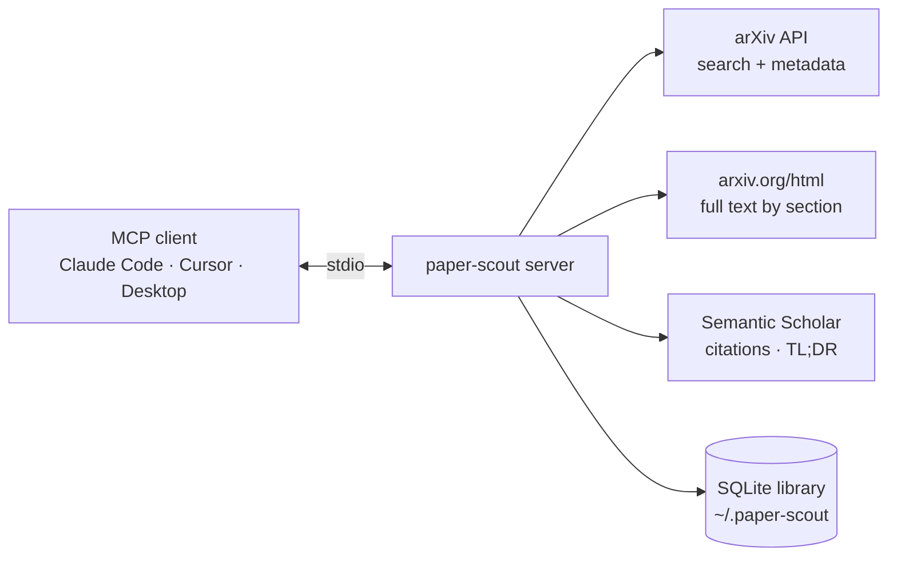

# 🔭 paper-scout-mcp

[](https://github.com/hasnat23/paper-scout-mcp/actions/workflows/ci.yml)
[](https://www.python.org/downloads/)
[](https://modelcontextprotocol.io)
[](LICENSE)

**Give your coding agent a research assistant.** An [MCP](https://modelcontextprotocol.io) server that lets Claude Code, Cursor, Claude Desktop
or any MCP client **search arXiv, read papers section by section, follow citation graphs, and keep a local reading library with notes and BibTeX export**.

No API keys required.

> *"Find the main follow-ups to Corrective RAG, read the method section of the most cited one, save both under `rag-robustness` and give me BibTeX."*
> One prompt, and the agent does the whole loop.

## ✨ Tools

| Tool | What it does |
|---|---|
| `search_papers` | arXiv search: free text (all terms must match) or arXiv syntax (`ti:`, `au:`, `abs:`, `cat:`), sort by relevance / newest / updated, filter by category |
| `get_paper` | Full metadata + abstract, plus **citation count, influential citations and TL;DR** from Semantic Scholar |
| `read_paper` | **Full text** from arXiv's HTML rendering: table of contents first, then one section at a time, so the agent reads only what it needs and saves context |
| `find_related` | Most-cited papers that **cite** this one, or that it **references** |
| `save_paper` | Save to a local SQLite library with tags and a note |
| `add_note` · `list_library` · `remove_paper` | Manage the library (filter by tag or text) |
| `export_bibtex` | BibTeX for a tag, specific ids, or everything |

Plus a `literature_review(topic)` **prompt** that walks the agent through search → read → related work → save → synthesis → BibTeX.

## 🚀 Setup

**Claude Code**

```bash
claude mcp add paper-scout -- uvx --from git+https://github.com/hasnat23/paper-scout-mcp paper-scout-mcp
```

**Cursor** (`~/.cursor/mcp.json`) / **Claude Desktop** (`claude_desktop_config.json`)

```json
{
  "mcpServers": {
    "paper-scout": {
      "command": "uvx",
      "args": ["--from", "git+https://github.com/hasnat23/paper-scout-mcp", "paper-scout-mcp"]
    }
  }
}
```

**From source**

```bash
git clone https://github.com/hasnat23/paper-scout-mcp && cd paper-scout-mcp
pip install -e .
paper-scout-mcp          # speaks MCP over stdio
```

## 🧪 Example output

These are real responses from the live APIs.

**`search_papers`** `{"query": "corrective retrieval augmented generation", "max_results": 3}`

```
1. **Open-Source Reproduction and Explainability Analysis of Corrective Retrieval Augmented Generation** (2026)
arXiv:2603.16169 · Surya Vardhan Yalavarthi · cs.IR, cs.AI, cs.CL
Corrective Retrieval Augmented Generation (CRAG) improves the robustness of RAG systems by evaluating ...

2. **Corrective Retrieval Augmented Generation** (2024)
arXiv:2401.15884 · Shi-Qi Yan, Jia-Chen Gu, Yun Zhu et al. · cs.CL
...
```

**`get_paper`** `{"arxiv_id": "2401.15884"}`

```
# Corrective Retrieval Augmented Generation
arXiv:2401.15884v3 · published 2024-01-29 · updated 2024-10-07
Authors: Shi-Qi Yan, Jia-Chen Gu, Yun Zhu, Zhen-Hua Ling
Categories: cs.CL
Citations: 320 (22 influential)
TL;DR: Experiments on four datasets covering short- and long-form generation tasks show that CRAG can
significantly improve the performance of RAG-based approaches ...
```

**`read_paper`** `{"arxiv_id": "2401.15884"}` returns the abstract and a table of contents (`1. 1 Introduction (5,117 chars)`, `4. 4 CRAG (10,848 chars)`, …).
Then `{"arxiv_id": "2401.15884", "section": "4"}` (or `"section": "CRAG"`) returns that section's text.

## 🧱 Design



- **Context-friendly reading**: `read_paper` returns a table of contents first; agents then pull single sections (truncated at `max_chars`) instead of a 60-page PDF.
- **Polite by default**: requests are spaced 3 s apart, as arXiv asks; Semantic Scholar 429s are retried with exponential backoff.
- **Optional keys**: set `S2_API_KEY` for a dedicated Semantic Scholar rate limit. `PAPER_SCOUT_HOME` moves the library (default `~/.paper-scout`).
- Older or non-LaTeX papers without an HTML version fall back to the abstract with a clear message.

## 🛠️ Development

```bash
pip install -e ".[dev]"
pytest          # offline: HTTP is mocked with httpx.MockTransport
```

Built with the official [MCP Python SDK](https://github.com/modelcontextprotocol/python-sdk) (v2, `MCPServer`).

## 📄 License

MIT © Muhammad Hasnat
